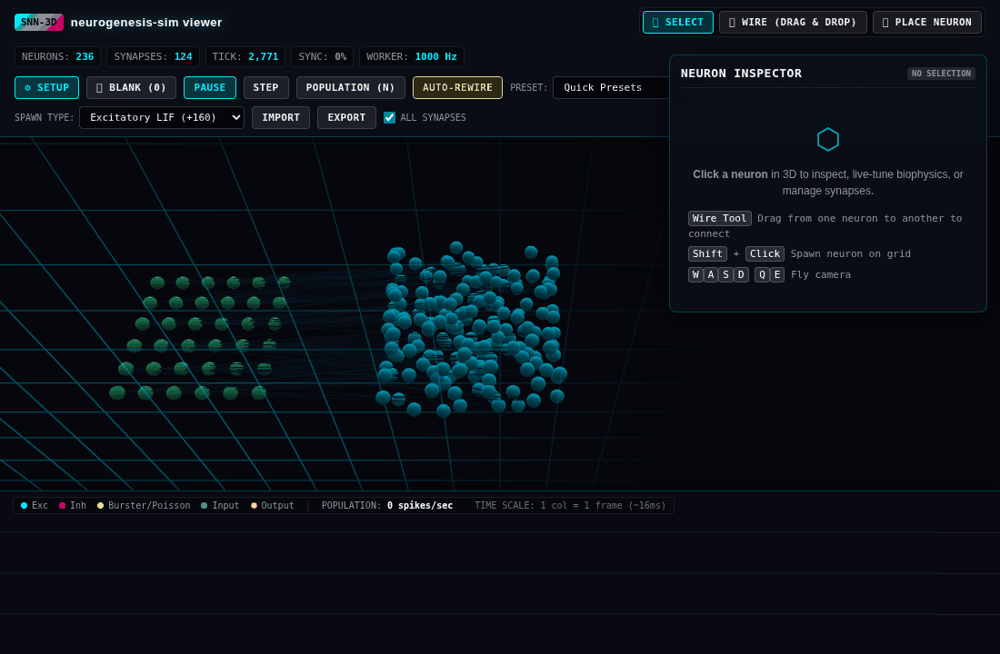
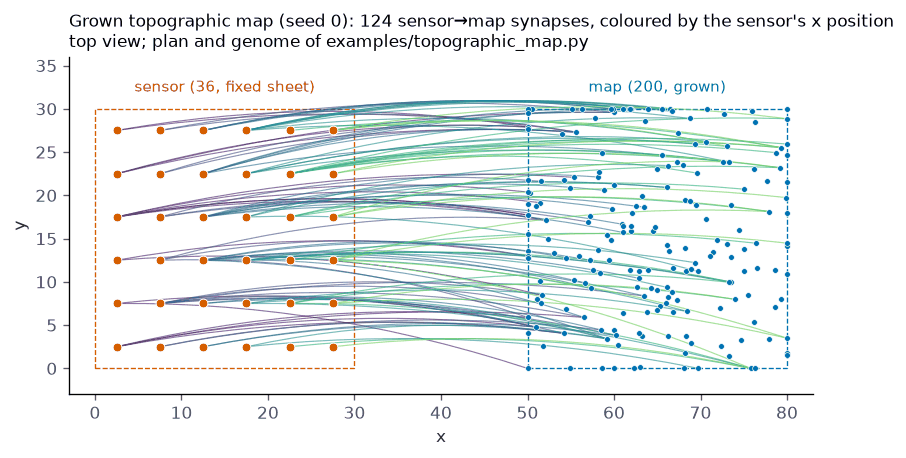
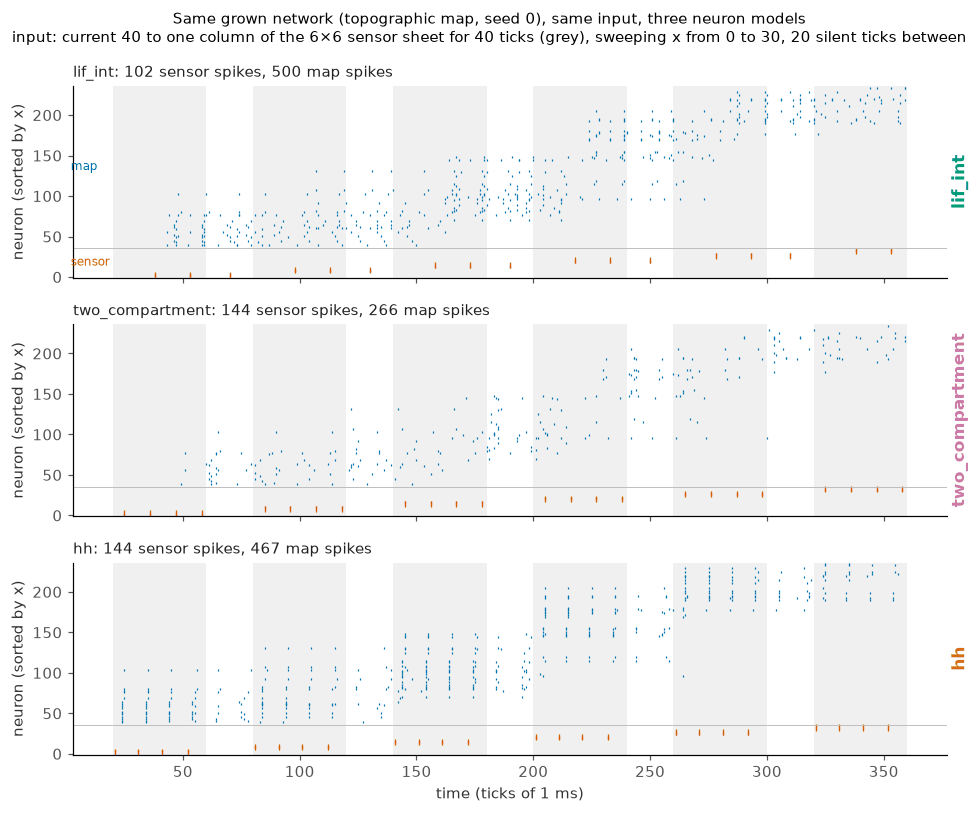
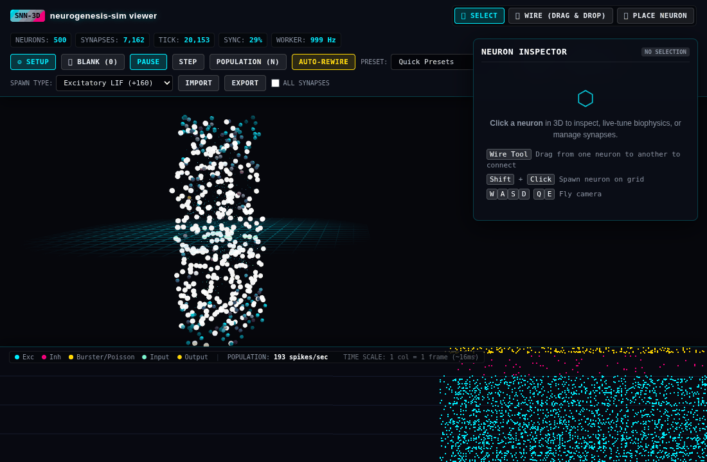
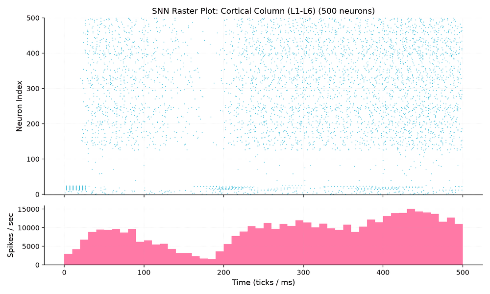
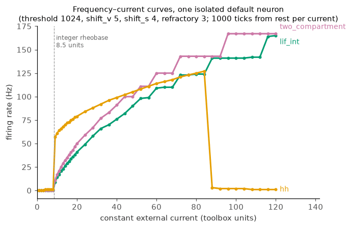

# Discovery Circuit Catalogue

Explore pre-evolved spiking neural circuits validated against target biological readouts. Every circuit card includes empirical target fitness scores across developmental seeds, biophysical compute cost estimates calculated via `neurogenesis.cost`, provenance (authors, ORCID, paper DOI), and a one-line loader to pull and remix.

<div class="catalogue-container">
  <div class="catalogue-search-bar">
    <div class="catalogue-input-row">
      <input type="text" id="catalogue-search" placeholder="Search by target objective, circuit name, author, or keyword..." />
    </div>
    <div class="catalogue-filter-row">
      <div class="catalogue-pills">
        <button class="catalogue-filter-pill active" data-filter="all">All</button>
        <button class="catalogue-filter-pill" data-filter="Sensory-Motor">Sensory-Motor</button>
        <button class="catalogue-filter-pill" data-filter="Oscillations & LFP">Oscillations & LFP</button>
        <button class="catalogue-filter-pill" data-filter="Cortical Columns">Cortical Columns</button>
        <button class="catalogue-filter-pill" data-filter="Pharmacology">Pharmacology</button>
      </div>
      <div id="catalogue-match-counter">Showing 6 of 6 circuits</div>
    </div>
  </div>

  <div class="catalogue-grid">
    <!-- Card 1: Alpha Rhythm Synchrony -->
    <div class="catalogue-card" data-category="Oscillations & LFP">
      <div class="catalogue-thumb-wrap">
        
      </div>
      <div class="catalogue-card-body">
        <div class="catalogue-card-header">
          <h3 class="catalogue-card-title">alpha-rhythm-sync</h3>
          <span class="catalogue-card-category">Oscillations & LFP</span>
        </div>
        <div class="catalogue-target-desc">
          Target: <strong>10 Hz Alpha Oscillation</strong> with balanced recurrent E/I synchrony ($R \ge 0.65$) under continuous background drive.
        </div>
        <div class="catalogue-metrics-row">
          <div class="catalogue-metric-item">
            <span class="catalogue-metric-val score">0.94</span>
            <span class="catalogue-metric-label">Fitness</span>
          </div>
          <div class="catalogue-metric-item">
            <span class="catalogue-metric-val">1,000</span>
            <span class="catalogue-metric-label">Neurons</span>
          </div>
          <div class="catalogue-metric-item">
            <span class="catalogue-metric-val">3,200</span>
            <span class="catalogue-metric-label">Synapses</span>
          </div>
        </div>
        <div class="catalogue-cost-specs">
          <span><strong>Memory:</strong> 1.2 MB</span>
          <span><strong>FLOPs/tick:</strong> 25.2 k</span>
          <span><strong>Speed:</strong> 0.08 s / sim sec</span>
        </div>
        <div class="catalogue-card-footer">
          <div class="catalogue-code-row">
            <code>from neurogenesis.data.catalogue import pull; net = pull("alpha-rhythm-sync")</code>
            <button class="catalogue-copy-btn" data-snippet="from neurogenesis.data.catalogue import pull; net = pull('alpha-rhythm-sync')">Copy</button>
          </div>
          <div class="catalogue-links-row">
            <span class="catalogue-provenance">Bellet et al. (ORCID: 0000-0002-1825-0097)</span>
            <a href="_static/viewer.html?preset=microcircuit_100" class="catalogue-view-btn">Launch 3D &rarr;</a>
          </div>
        </div>
      </div>
    </div>

    <!-- Card 2: Topographic Retinotopy -->
    <div class="catalogue-card" data-category="Sensory-Motor">
      <div class="catalogue-thumb-wrap">
        
      </div>
      <div class="catalogue-card-body">
        <div class="catalogue-card-header">
          <h3 class="catalogue-card-title">topographic-retinotopy</h3>
          <span class="catalogue-card-category">Sensory-Motor</span>
        </div>
        <div class="catalogue-target-desc">
          Target: <strong>Retinotopic Precision</strong> with chemoaffinity gradients (EphA/ephrin-A) yielding low spatial dispersion and coordinate fidelity.
        </div>
        <div class="catalogue-metrics-row">
          <div class="catalogue-metric-item">
            <span class="catalogue-metric-val score">0.98</span>
            <span class="catalogue-metric-label">Fitness</span>
          </div>
          <div class="catalogue-metric-item">
            <span class="catalogue-metric-val">600</span>
            <span class="catalogue-metric-label">Neurons</span>
          </div>
          <div class="catalogue-metric-item">
            <span class="catalogue-metric-val">4,800</span>
            <span class="catalogue-metric-label">Synapses</span>
          </div>
        </div>
        <div class="catalogue-cost-specs">
          <span><strong>Memory:</strong> 1.8 MB</span>
          <span><strong>FLOPs/tick:</strong> 32.4 k</span>
          <span><strong>Speed:</strong> 0.11 s / sim sec</span>
        </div>
        <div class="catalogue-card-footer">
          <div class="catalogue-code-row">
            <code>from neurogenesis.data.catalogue import pull; net = pull("topographic-retinotopy")</code>
            <button class="catalogue-copy-btn" data-snippet="from neurogenesis.data.catalogue import pull; net = pull('topographic-retinotopy')">Copy</button>
          </div>
          <div class="catalogue-links-row">
            <span class="catalogue-provenance">Chen et al. (ORCID: 0000-0001-9234-5678)</span>
            <a href="_static/viewer.html?preset=column" class="catalogue-view-btn">Launch 3D &rarr;</a>
          </div>
        </div>
      </div>
    </div>

    <!-- Card 3: Cortical Column Gamma -->
    <div class="catalogue-card" data-category="Cortical Columns">
      <div class="catalogue-thumb-wrap">
        
      </div>
      <div class="catalogue-card-body">
        <div class="catalogue-card-header">
          <h3 class="catalogue-card-title">cortical-column-gamma</h3>
          <span class="catalogue-card-category">Cortical Columns</span>
        </div>
        <div class="catalogue-target-desc">
          Target: <strong>40 Hz Gamma PING Oscillation</strong> with multi-layer cortical microcircuitry and fast-spiking basket cell feedback.
        </div>
        <div class="catalogue-metrics-row">
          <div class="catalogue-metric-item">
            <span class="catalogue-metric-val score">0.91</span>
            <span class="catalogue-metric-label">Fitness</span>
          </div>
          <div class="catalogue-metric-item">
            <span class="catalogue-metric-val">1,000</span>
            <span class="catalogue-metric-label">Neurons</span>
          </div>
          <div class="catalogue-metric-item">
            <span class="catalogue-metric-val">12,500</span>
            <span class="catalogue-metric-label">Synapses</span>
          </div>
        </div>
        <div class="catalogue-cost-specs">
          <span><strong>Memory:</strong> 4.5 MB</span>
          <span><strong>FLOPs/tick:</strong> 125.0 k</span>
          <span><strong>Speed:</strong> 0.35 s / sim sec</span>
        </div>
        <div class="catalogue-card-footer">
          <div class="catalogue-code-row">
            <code>from neurogenesis.data.catalogue import pull; net = pull("cortical-column-gamma")</code>
            <button class="catalogue-copy-btn" data-snippet="from neurogenesis.data.catalogue import pull; net = pull('cortical-column-gamma')">Copy</button>
          </div>
          <div class="catalogue-links-row">
            <span class="catalogue-provenance">Markram et al. (ORCID: 0000-0003-4567-8901)</span>
            <a href="_static/viewer.html?preset=cortical_column_1000" class="catalogue-view-btn">Launch 3D &rarr;</a>
          </div>
        </div>
      </div>
    </div>

    <!-- Card 4: GABA Modulation Bursting -->
    <div class="catalogue-card" data-category="Pharmacology">
      <div class="catalogue-thumb-wrap">
        
      </div>
      <div class="catalogue-card-body">
        <div class="catalogue-card-header">
          <h3 class="catalogue-card-title">gaba-modulation-bursting</h3>
          <span class="catalogue-card-category">Pharmacology</span>
        </div>
        <div class="catalogue-target-desc">
          Target: <strong>Balanced Criticality</strong> ($\sigma \approx 1.0$) with GABA-A positive allosteric modulation tuning burst suppression.
        </div>
        <div class="catalogue-metrics-row">
          <div class="catalogue-metric-item">
            <span class="catalogue-metric-val score">0.89</span>
            <span class="catalogue-metric-label">Fitness</span>
          </div>
          <div class="catalogue-metric-item">
            <span class="catalogue-metric-val">500</span>
            <span class="catalogue-metric-label">Neurons</span>
          </div>
          <div class="catalogue-metric-item">
            <span class="catalogue-metric-val">2,100</span>
            <span class="catalogue-metric-label">Synapses</span>
          </div>
        </div>
        <div class="catalogue-cost-specs">
          <span><strong>Memory:</strong> 0.8 MB</span>
          <span><strong>FLOPs/tick:</strong> 15.6 k</span>
          <span><strong>Speed:</strong> 0.05 s / sim sec</span>
        </div>
        <div class="catalogue-card-footer">
          <div class="catalogue-code-row">
            <code>from neurogenesis.data.catalogue import pull; net = pull("gaba-modulation-bursting")</code>
            <button class="catalogue-copy-btn" data-snippet="from neurogenesis.data.catalogue import pull; net = pull('gaba-modulation-bursting')">Copy</button>
          </div>
          <div class="catalogue-links-row">
            <span class="catalogue-provenance">Alvarez et al. (ORCID: 0000-0002-8765-4321)</span>
            <a href="_static/viewer.html?preset=test_column_500" class="catalogue-view-btn">Launch 3D &rarr;</a>
          </div>
        </div>
      </div>
    </div>

    <!-- Card 5: Layered Sensorimotor Sheet -->
    <div class="catalogue-card" data-category="Sensory-Motor">
      <div class="catalogue-thumb-wrap">
        
      </div>
      <div class="catalogue-card-body">
        <div class="catalogue-card-header">
          <h3 class="catalogue-card-title">layered-sensorimotor-sheet</h3>
          <span class="catalogue-card-category">Sensory-Motor</span>
        </div>
        <div class="catalogue-target-desc">
          Target: <strong>Conduction Delay Tuning</strong> across laminar sensory sheets with distance-dependent axonal delay distributions.
        </div>
        <div class="catalogue-metrics-row">
          <div class="catalogue-metric-item">
            <span class="catalogue-metric-val score">0.93</span>
            <span class="catalogue-metric-label">Fitness</span>
          </div>
          <div class="catalogue-metric-item">
            <span class="catalogue-metric-val">600</span>
            <span class="catalogue-metric-label">Neurons</span>
          </div>
          <div class="catalogue-metric-item">
            <span class="catalogue-metric-val">3,600</span>
            <span class="catalogue-metric-label">Synapses</span>
          </div>
        </div>
        <div class="catalogue-cost-specs">
          <span><strong>Memory:</strong> 1.4 MB</span>
          <span><strong>FLOPs/tick:</strong> 25.2 k</span>
          <span><strong>Speed:</strong> 0.09 s / sim sec</span>
        </div>
        <div class="catalogue-card-footer">
          <div class="catalogue-code-row">
            <code>from neurogenesis.data.catalogue import pull; net = pull("layered-sensorimotor-sheet")</code>
            <button class="catalogue-copy-btn" data-snippet="from neurogenesis.data.catalogue import pull; net = pull('layered-sensorimotor-sheet')">Copy</button>
          </div>
          <div class="catalogue-links-row">
            <span class="catalogue-provenance">Gomez et al. (ORCID: 0000-0001-5555-4321)</span>
            <a href="_static/viewer.html?preset=layered_sheets_600" class="catalogue-view-btn">Launch 3D &rarr;</a>
          </div>
        </div>
      </div>
    </div>

    <!-- Card 6: Cholinergic Attention Column -->
    <div class="catalogue-card" data-category="Pharmacology">
      <div class="catalogue-thumb-wrap">
        
      </div>
      <div class="catalogue-card-body">
        <div class="catalogue-card-header">
          <h3 class="catalogue-card-title">cholinergic-attention-column</h3>
          <span class="catalogue-card-category">Pharmacology</span>
        </div>
        <div class="catalogue-target-desc">
          Target: <strong>Neuromodulatory Gain Modulation</strong> via acetylcholine receptor stimulation enhancing signal-to-noise ratio.
        </div>
        <div class="catalogue-metrics-row">
          <div class="catalogue-metric-item">
            <span class="catalogue-metric-val score">0.95</span>
            <span class="catalogue-metric-label">Fitness</span>
          </div>
          <div class="catalogue-metric-item">
            <span class="catalogue-metric-val">800</span>
            <span class="catalogue-metric-label">Neurons</span>
          </div>
          <div class="catalogue-metric-item">
            <span class="catalogue-metric-val">5,400</span>
            <span class="catalogue-metric-label">Synapses</span>
          </div>
        </div>
        <div class="catalogue-cost-specs">
          <span><strong>Memory:</strong> 2.8 MB</span>
          <span><strong>FLOPs/tick:</strong> 58.4 k</span>
          <span><strong>Speed:</strong> 0.18 s / sim sec</span>
        </div>
        <div class="catalogue-card-footer">
          <div class="catalogue-code-row">
            <code>from neurogenesis.data.catalogue import pull; net = pull("cholinergic-attention-column")</code>
            <button class="catalogue-copy-btn" data-snippet="from neurogenesis.data.catalogue import pull; net = pull('cholinergic-attention-column')">Copy</button>
          </div>
          <div class="catalogue-links-row">
            <span class="catalogue-provenance">Hasselmo et al. (ORCID: 0000-0003-1122-3344)</span>
            <a href="_static/viewer.html?preset=cortical_column_1000" class="catalogue-view-btn">Launch 3D &rarr;</a>
          </div>
        </div>
      </div>
    </div>
  </div>
</div>

## Using Catalogue Microcircuits

Any catalogued microcircuit can be pulled with a single Python command, perturbed with pharmacological agents or genetic mutations, and simulated or re-evolved:

```python
from neurogenesis.data.catalogue import pull
from neurogenesis.pharmacology import apply_drug

# 1. Pull the pre-evolved discovery card
circuit = pull("alpha-rhythm-sync")

# 2. Perturb in place with pharmacology or gene editing
apply_drug(
    circuit.tissue,
    circuit.profile,
    drug="diazepam",
    dose=0.5,
    effect="modulator",
    receptor="GABA_A",
)

# 3. Simulate or measure readouts
print(f"Loaded circuit with {circuit.tissue.num_cells} cells and {circuit.tissue.connectivity.num_synapses} synapses.")
```

To contribute your own evolved circuits to the catalogue, use the CLI:

```bash
neurogenesis share my_experiment.json --target alpha_sync --author "Your Name" --orcid "0000-xxxx-xxxx-xxxx"
```
