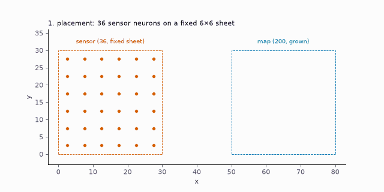
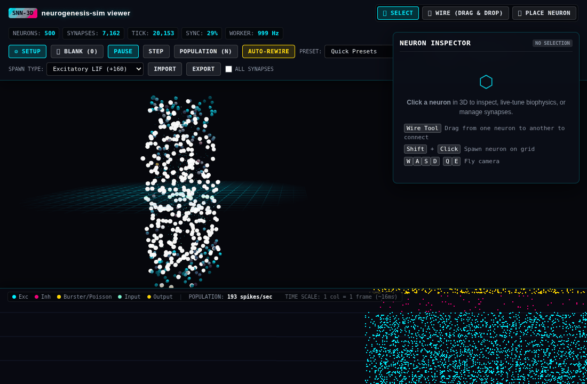

# neurogenesis-sim

**Grow spiking neural networks the way nervous systems are built, by hand, by genes, or both, and simulate them
cheaply.**

<div id="ng-hero-anim-root"><noscript>The interactive playground needs JavaScript.</noscript></div>
<script src="_static/ngjs/ng-core.js"></script>
<script src="_static/ngjs/ng-hero.js"></script>

**What runs above.** A JavaScript port of the toolbox grows each individual through six stages (cell-cycle exit,
interneuron production, radial and tangential migration, chemoaffinity axon guidance, competitive elimination during
spontaneous waves) and simulates it with the integer `lif_int` kernel, whose spikes are identical to the Python
reference. The task is a toy one: the cortex must report where its thalamic input was flashed, at a low energy cost.
Each generation keeps the best of its offspring, so you can see which stage selection changes first. The model, its
genes, its simplifications and the JavaScript API are described in {doc}`getting-started/playground`.

neurogenesis-sim is a general toolbox for building circuits through development. You describe where tissue is (2D or
3D shapes) and what is already known about it (layers, areas, maps, cell positions). You then choose a sequence of
developmental stages (cell division, migration, differentiation, axon growth, pruning, activity-dependent refinement
...). For every parameter of every stage you decide whether it is set **by hand**, read from a **hand-drawn field**,
controlled by **genes** (and then evolved), or **fitted to data**. The result is a spiking network that can be
simulated, measured, evolved and shared as a module.

| Workflow | What you specify | What development does |
|---|---|---|
| Supervised (by hand) | geometry, cells, connections or connection rules | compiles and simulates exactly what you specified |
| Unsupervised (genetic) | a genome and a schedule of stages | genes control every stage; evolution searches genomes that work for every developmental seed |
| Semi-supervised | a hand-made scaffold (layers, maps, landmarks) plus a schedule | genes and fitted parameters work on top of the scaffold |

## The same idea in Python
The toolbox's own `grow` and island evolution (`neurogenesis.evolution.islands.evolve`) on a sensor sheet projecting
onto a grown map: two guidance genes (receptor-gradient gain and arbor spread) evolve until the map reports where the
sheet is stimulated. It runs in a few seconds on a laptop CPU and prints the best fitness (minus the decoding error) of
each generation.

```python
import numpy as np
from neurogenesis.development import BodyPlan, FixedPlacement, Region, grow, region_of
from neurogenesis.evolution.islands import evolve
from neurogenesis.spiking.batch import simulate_counts

# A sensor sheet (hand-placed scaffold) projects onto a map grown from a genome.
sheet = [[(i + 0.5) / 6, (j + 0.5) / 6, 0.5] for i in range(6) for j in range(6)]
plan = BodyPlan(name="map", regions=[
    Region("sensor", origin=(0, 0, 0), size=(30, 30, 5), placement=FixedPlacement(sheet), role=1),
    Region("map", origin=(50, 0, 0), size=(30, 30, 10))], projections=[("sensor", "map")])
founder = dict(count=dict(map=200), inh_weight_factor=2.0, w_clip=2047,
               migration=dict(map=dict(mean=np.full(3, 0.5), spread=0.35)),
               inhibitory=dict(map=dict(a0=-6.0, a=np.zeros(3))),
               guidance={("sensor", "map"): dict(B=np.zeros((3, 3)), c=np.zeros(3), sigma=0.3, p0=0.9, w=900.0)})
genes = [(("guidance", ("sensor", "map"), "B", 0, 0), -3.0, 3.0),   # receptor-gradient gain along u (0: no map)
         (("guidance", ("sensor", "map"), "sigma"), 0.05, 0.5)]      # arbor spread

def evaluate(genomes, seeds):
    """Fitness: stimulate sensor columns along u; the map's spike-weighted mean u should follow (minus error)."""
    fit = []
    for g in genomes:
        err = []
        for seed in seeds:
            net = grow(plan, g, seed=seed)
            sensor, target = region_of(net, plan, "sensor"), region_of(net, plan, "map")
            u = np.array([net.neurons[i].x for i in target]) / 30 - 50 / 30
            ext = np.zeros((6, net.num_neurons), np.int32)
            for col in range(6):
                ext[col, sensor[col * 6:(col + 1) * 6]] = 120     # one column of the sheet per stimulus
            counts = simulate_counts([net], [ext], ticks=40)[0][:, target]
            dec = (counts @ u) / np.maximum(counts.sum(1), 1)
            err.append(np.sqrt(np.mean((dec - (np.arange(6) + 0.5) / 6) ** 2)))
        fit.append(-float(np.mean(err)))
    return fit, [{} for _ in genomes]

population, history = evolve(founder, genes, evaluate, pop=8, gens=6, seeds_per_gen=2, parents=3, sigma=0.15)
print([round(h["best"], 3) for h in history])
```

<div class="ng-figs">
  <figure>
    
    <figcaption>A topographic map grown from a genome (<code>examples/topographic_map.py</code>, seed 0): sensor→map
    synapses coloured by the sensor's position. See <a href="use-cases/topographic-map.html">the use case</a>.</figcaption>
  </figure>
  <figure>
    
    <figcaption>The browser viewer running a 500-neuron column made with
    <code>python -m neurogenesis generate</code>, with its spike raster. See <a href="tutorials/viewer.html">the viewer tutorial</a>.</figcaption>
  </figure>
</div>

## For AI assistants
The whole documentation is also published as one Markdown file, with a generated status section (what exists, what
is not done yet, open pull requests), to paste or upload into a chat with an AI assistant:
[neurogenesis-sim-context.md](https://jobellet.github.io/neurogenesis-sim/neurogenesis-sim-context.md) (about 70k
tokens), or the short [neurogenesis-sim-brief.md](https://jobellet.github.io/neurogenesis-sim/neurogenesis-sim-brief.md)
(about 11k tokens). Both are rebuilt with the site; `python scripts/build_context.py` makes them locally.

## Highlights
- **One integer spiking kernel, four implementations with identical spikes:** Python reference, JAX (CPU / GPU), the
  browser (TypeScript) and a portable C library (`nglif`) used by the desktop apps.
- **Switchable neuron models** on the same grown network: integer LIF, two-compartment, Hodgkin–Huxley.
- **Know the cost before you run:** memory and time per model, calibrated on your machine
  (`python -m neurogenesis estimate`).
- **Development as data:** body plans, genomes, schedules of stages and parameter sources are JSON files.
- **Evolution that generalises across development:** island model with fresh developmental seeds each generation and
  audits on held-out seeds.
- **Modules:** share a working circuit (plan + genome + interface + validation) and compose it with others.
- **Viewers and apps:** a 3D browser viewer, a native macOS app and a Windows / Linux app (in progress).

```{admonition} Project status (November 2026)
:class: warning
The spiking kernels, neuron models, cost estimates, body plans with the fixed growth procedure, genomes, evolution,
modules, the browser viewer and the bridge are tested and usable. Configurable developmental stages, fields,
geometries, fitting, connectome import, pharmacology, arbors and SONATA export work end to end and are tested; the
stages are young and their API may still change (see
{doc}`development/roadmap`).
```

```{toctree}
:maxdepth: 2
:caption: Getting started

getting-started/installation
getting-started/quickstart
getting-started/playground
getting-started/concepts
```

```{toctree}
:maxdepth: 2
:caption: Discovery Catalogue

catalogue
```

```{toctree}
:maxdepth: 2
:caption: Tutorials

tutorials/index
```

```{toctree}
:maxdepth: 2
:caption: Use cases

use-cases/index
```

```{toctree}
:maxdepth: 2
:caption: Integration

integration/index
```

```{toctree}
:maxdepth: 2
:caption: Reference

reference/layout
reference/cli
reference/stages
reference/api
reference/project-format
reference/profiles
reference/neuron-models
reference/bridge-protocol
reference/ui-schema
reference/glossary
```

```{toctree}
:maxdepth: 2
:caption: Background

background/design-principles
background/literature
background/developmental-questions
```

```{toctree}
:maxdepth: 1
:caption: Project

development/roadmap
development/contributing
development/agents
development/extending
development/third-party
faq
citing
changelog
```
