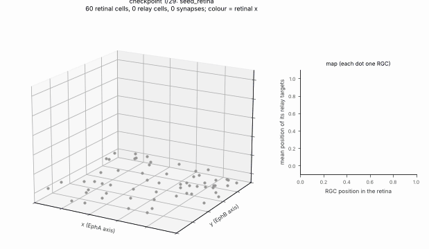

# Retina → thalamic relay: guidance, waves and their ablation

A toy two-region model loosely after the mouse retina → dLGN projection (E14–P14), grown by the stage pipeline and
compared across four conditions. Everything below holds **in this simulation** only; it is a demonstration of how to
set up and test a developmental hypothesis with the toolbox, not a biological finding.

    python examples/retinothalamic.py --cpu --seeds 10 --out out_dir      # about 1.5 min on 2 CPU threads
    python examples/retinothalamic.py --cpu --seeds 2 --small             # test configuration, about 10 s

The hypotheses, metrics and pass criteria were written before the runs: {doc}`../hypotheses/2026-11-02-retinothalamic`.



*Proof of principle (WT, seed 0, run 2 below): one frame per development checkpoint, then a turn around the final
network and the same seed with EphA knocked out. Left: retina (bottom: grey progenitors and other cells, circles RGCs)
and relay (top: squares relay cells, triangles interneurons); RGCs, their axons and relay cells are coloured by retinal
x (relay cells: weighted mean over their retinal inputs). Right: each RGC's retinal position against the mean relay
position of its targets, per axis; a diagonal is a topographic map. Made by `docs/_scripts/make_media.py retino`.*

```{toctree}
:hidden:

../hypotheses/2026-11-02-retinothalamic
```

## Model
Two `Box` regions (a 100 × 100 retinal sheet, a 60 × 60 × 20 relay nucleus; in run 1 placed far away so that the retinal waves,
which spread through space, never reach it) and analytic x / y gradient fields. Stages (docs/STAGES.md):
`seed_cells`, `proliferate`, `express` (one fate gene with lateral inhibition through `neighbor_weights`, and two
graded genes read from the x / y gradient fields), `differentiate` (RGCs, other retinal cells, relay cells, relay
interneurons), `migrate`, `mosaic` (RGCs only), `grow_axons` (exuberant retina → relay projection, `sigma` 0.3, target
gain per axis `B = diag(2·EphA gain, 2·EphB gain, 0)`; interneuron → relay), `apoptosis` (relay cells with fewer than 3
inputs, through a per-cell `Field` for `min_inputs`), `set_transmitters` / `express_receptors` / `assign_receptors` /
`pharmacology` (context `immature`, depolarising GABA-A), four `refine_by_activity` calls with one propagating wave each
(random origin, speed 0.4 space units per tick, one 600-unit tick of drive per RGC) and STDP (`A_plus` 20,
`A_minus` 21), `pharmacology` (`mature`), `scale` (incoming sum 1500), `prune` (|w| < 150), `myelinate`
(retinal axons, factor 0.5), `freeze` (Dale check).

Conditions (genome values, `condition_genome`): **WT**; **b2KO**: no waves, RGCs fire as independent Poisson sources
at the same mean rate as one wave gives (one spike per RGC per 300-tick window); **TTX**: no refinement stages (no
spikes); **EphAKO**: x chemoaffinity gain 0.

## Results, run 1 (as pre-registered; 10 development seeds per condition, seeds 0–9, mean ± SD)

| Condition | Mosaic NND/SD | r_x | r_y | Topographic error | Corner separation |
|---|---|---|---|---|---|
| WT     | 2.77 ± 0.53 | 0.910 ± 0.021 | 0.907 ± 0.031 | 0.232 ± 0.016 | 0.700 ± 0.078 |
| b2KO   | 2.77 ± 0.53 | 0.913 ± 0.018 | 0.912 ± 0.025 | 0.233 ± 0.014 | 0.687 ± 0.087 |
| TTX    | 2.77 ± 0.53 | 0.914 ± 0.021 | 0.911 ± 0.027 | 0.234 ± 0.015 | 0.684 ± 0.091 |
| EphAKO | 2.77 ± 0.53 | 0.021 ± 0.159 | 0.911 ± 0.025 | 0.396 ± 0.020 | 0.655 ± 0.097 |

Paired differences from WT (same seed), mean ± SD: TTX topographic error +0.0029 ± 0.0026 (higher in 9 of 10 seeds),
separation −0.017 ± 0.024 (lower in 6 of 10); b2KO error +0.0019 ± 0.0033 (7 of 10), separation −0.013 ± 0.020
(7 of 10); EphAKO error +0.164 ± 0.021 (10 of 10), r_x −0.889 ± 0.166. Per-seed values: `retinothalamic-results.json`
next to this page. About 66 RGCs, 145 relay cells and 710 retinal synapses per network.

## Which predictions held
- **H1 (mosaic unaffected): held, trivially.** The ablations act only on stages after `mosaic`, and every stage has its
  own random stream, so the mosaic is identical across conditions for a given seed. The mosaic is regular
  (NND/SD 2.8 against about 1.9 for random positions).
- **H2 (EphA-KO lowers r_x, not r_y): held.** r_x falls from 0.91 to 0.02 (|r_x| < 0.3), r_y changes by +0.004.
- **H3 (activity loss keeps the axes but blurs the map): orientation held; blurring weak.** TTX and b2KO keep
  r_x, r_y > 0.9. Their topographic error is higher and their corner separation lower than WT in the predicted
  direction, but every difference is far smaller than one pooled SD (the pre-registered criterion for "clear"), so the
  refinement effect is **weak** in this model. With a broad initial projection and only four waves, STDP followed by
  scaling and pruning changes the map little; most of the map's precision comes from the chemoaffinity term.

## Results, run 2 (after the toolbox fixes; not pre-registered)
The defects listed below were fixed in #81 and #82, and the example was changed to use the fixes: waves reach only
the retina (`waves.cells`), so the relay sits just above it (box centre z = 40 instead of 1000, `conduction_velocity`
8 instead of 200 so that delays stay about the same, trophic field threshold z > 20); `restore_modes` turns the β2-KO
Poisson drivers off after each refinement stage. Everything else, including the seeds, is unchanged. These changes
were made after run 1 was seen, so run 2 is a check that the conclusions survive the fixes, not a new test.

| Condition | Mosaic NND/SD | r_x | r_y | Topographic error | Corner separation |
|---|---|---|---|---|---|
| WT     | 2.77 ± 0.53 | 0.911 ± 0.021 | 0.911 ± 0.022 | 0.230 ± 0.016 | 0.671 ± 0.088 |
| b2KO   | 2.77 ± 0.53 | 0.913 ± 0.019 | 0.911 ± 0.026 | 0.233 ± 0.014 | 0.665 ± 0.088 |
| TTX    | 2.77 ± 0.53 | 0.914 ± 0.021 | 0.911 ± 0.027 | 0.234 ± 0.015 | 0.655 ± 0.100 |
| EphAKO | 2.77 ± 0.53 | 0.033 ± 0.157 | 0.911 ± 0.026 | 0.394 ± 0.019 | 0.619 ± 0.105 |

Paired differences from WT (same seed): TTX topographic error +0.0040 ± 0.0028 (higher in 9 of 10 seeds), separation
−0.015 ± 0.027 (lower in 7 of 10); b2KO error +0.0029 ± 0.0027 (8 of 10), separation −0.006 ± 0.019 (7 of 10);
EphAKO error +0.164 ± 0.022 (10 of 10), r_x −0.878 ± 0.163. Per-seed values: `retinothalamic-results-run2.json`.
The conclusions of run 1 hold: H2 held, and H3 held in orientation with a **weak** blurring (every difference far
smaller than one SD).

## Relay shaped by an atlas (P4)
The relay box can be replaced by the shape of a real nucleus from an annotation atlas, here intended to be the dorsal
lateral geniculate nucleus at P4 in the Allen Developing Mouse Brain Reference Atlas (Thompson et al. 2014, Neuron):
at P4 retinal axons have reached the dLGN and waves refine the map. The atlas files are not in the repository (Allen
Institute terms of use; cite the atlas): download the P4 annotation volume and the structure ontology, then

    python examples/atlas_relay_mask.py --annotation P4_annotation.nrrd --ontology structures.json --find geniculate
    python examples/atlas_relay_mask.py --annotation P4_annotation.nrrd --ontology structures.json \
        --structure <acronym> --out relay_mask.npz
    python examples/retinothalamic.py --relay-mask relay_mask.npz --cpu --seeds 10

`neurogenesis.data.atlas` reads the volume and the ontology and cuts the structure (with its descendants) as a voxel
geometry; the example scales it, keeping its proportions, into its relay box (largest side 60 space units), so the atlas
sets the nucleus's **shape**, not the model's size or units. The retina stays a hand-made sheet: the eye is not part of
the brain atlas. Tested on a synthetic atlas (`tests/test_examples.py`); results with the real P4 atlas are not reported
yet.

## Limits and toolbox findings
Found while writing this example (run 1), fixed afterwards:
- `refine_by_activity` ignored its `waves` (and `twitches`) settings when run from a schedule (`run_schedule` wraps a
  dict param in `Const`); fixed in #81. Run 1 used an equivalent workaround, so its numbers are not affected.
- `grow_axons` resolved guidance values one level deep, so `B` could not hold per-axis `Gene`s; fixed in #82 (the
  example still builds `B` in Python from the condition genome).
- Waves were applied to every cell in space, so run 1 placed the relay 1000 space units away; #82 adds `waves.cells`,
  used in run 2.
- `mosaic` with a `boundary` cancelled every step of cells that started outside the geometry; fixed in #82 (the example
  still runs it without a boundary).
- `sources` left β2-KO cells as Poisson drivers after refinement (also in the final network); #82 adds
  `restore_modes`, used in run 2.

Still open:
- The graded genes produced by `express` are not read by any guidance rule (no expression-based target rule), so the
  EphA / EphB expression is illustrative and the gain in `B` carries the effect.
- Before the reported runs, the activity regime was set on pilot seeds 100–102 (not reported): wave drive of one
  600-unit tick (larger drive made RGCs and relay cells fire for tens of ticks), relay refractory period 5 ticks and a
  weak interneuron projection (otherwise the relay fired continuously under immature GABA), `scale` before `prune`, and
  the STDP amplitudes. These settings were chosen for a sensible firing regime, but they were tried with the outcome
  visible, so the weak H3 effect should not be read as a property of the mechanism in general.
