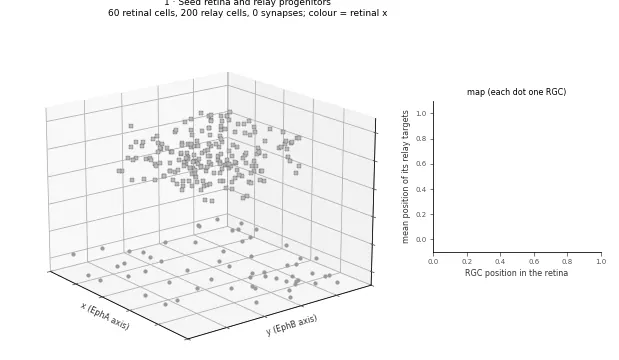
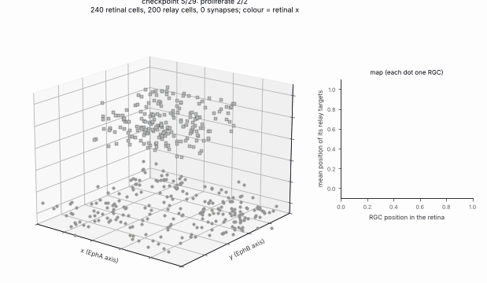
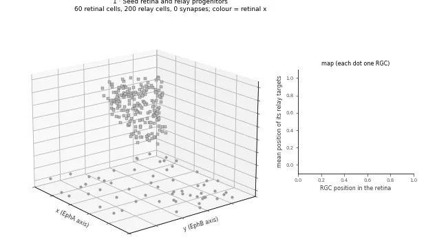

# Retina → relay: a small topographic-map experiment

```{raw} html
<div class="ng-question-box">
  <p><strong>Guiding Question:</strong> <em>How does the retinotopy of the retina align with that of the lateral geniculate nucleus (dLGN) before the onset of vision—and what are the respective roles of graded molecular cues (Eph/ephrin) and patterned spontaneous retinal waves in wiring and refining this map?</em></p>
</div>
```

This worked example grows a toy retinal projection into a relay, then asks whether the map depends on EphA guidance
and activity-driven refinement. It demonstrates how to turn a developmental idea into a model and compare conditions.
The results describe **this simulation**, not measured biology. Step through the interactive carousel below to
inspect each stage of the `examples/retinothalamic.py` pipeline (E14–P14), the CLI command that advances the
simulation from one stage checkpoint to the next, and the primary developmental literature.

## Main result

| Question | Result in this simulation |
|---|---|
| Does the EphA knockout disrupt the x map? | Yes. In the p2A-shaped relay, r_x falls from 0.832 in WT to 0.013. The y map remains (r_y 0.769). |
| Does activity deprivation blur the map? | Only weakly in this setup: the change is smaller than the across-seed variation. |
| Does relay shape matter? | The equal-volume box has stronger map scores than p2A. Its smaller dimensions also change spatial extent, so this does not isolate shape alone. |

## Read the animation

The animation shows seven development milestones, then the final wild type and an EphA knockout with the same seed.
The **left panel** is the network in space: retina at the bottom, relay above it; circles are retinal cells, squares
are relay cells, and triangles are relay interneurons. Lines show a sample of retinal synapses. **Colour follows
retinal x** from purple to yellow. Relay cells inherit the weighted mean colour of their retinal inputs. In the **right
panel**, each dot is one retinal ganglion cell (RGC): x position in the retina is
plotted against the mean x or y position of its relay targets (blue = x/EphA axis, orange = y/EphB axis). A rising
diagonal means that axis is mapped in order. The knockout keeps the orange trend and loses the blue one.



*Proof of principle (WT, seed 0, run 2 below): one frame per development checkpoint, then a turn around the final
network and the same seed with EphA knocked out. Left: retina (bottom: grey progenitors and other cells, circles RGCs)
and relay (top: squares relay cells, triangles interneurons); RGCs, their axons and relay cells are coloured by retinal
x (relay cells: weighted mean over their retinal inputs). Right: each RGC's retinal position against the mean relay
position of its targets, per axis; a diagonal is a topographic map. Made by `docs/_scripts/make_media.py retino`.*

```{toctree}
:hidden:

../hypotheses/2026-11-02-retinothalamic
../hypotheses/2026-11-03-retinothalamic-expression
```

The hypotheses, metrics and pass criteria were written before the runs: {doc}`../hypotheses/2026-11-02-retinothalamic`.

    python examples/retinothalamic.py --cpu --seeds 10 --out out_dir      # about 1.5 min on 2 CPU threads
    python examples/retinothalamic.py --cpu --seeds 2 --small             # test configuration, about 10 s

## Model

```{raw} html
<div class="ng-retino-carousel">
  <div class="ng-carousel-header">
    <div class="ng-nav-row">
      <div class="ng-counter-group">
        <button id="ng-prev-btn" class="ng-nav-btn" title="Previous stage (Left arrow)">&larr;</button>
        <span id="ng-stage-counter">Stage 1 / 12</span>
        <button id="ng-next-btn" class="ng-nav-btn" title="Next stage (Right arrow)">&rarr;</button>
      </div>
      <div class="ng-toggle-group">
        <button id="ng-toggle-box" class="ng-toggle-btn active" title="Box Relay geometry (Run 2)">Box Relay (Run 2)</button>
        <button id="ng-toggle-p4" class="ng-toggle-btn" title="P4 Atlas Relay p2A geometry (Run 3)">P4 Atlas Relay p2A (Run 3)</button>
      </div>
    </div>
    <div id="ng-pills-container" class="ng-pills-bar">
      <!-- pills populated by JS -->
    </div>
  </div>

  <div class="ng-carousel-body">
    <div class="ng-visual-pane">
      
    </div>
    <div class="ng-info-pane">
      <div class="ng-stage-title-row">
        <h3 id="ng-stage-title">1. Progenitor Seeding & Proliferation</h3>
        <span id="ng-stage-age">E14–E15</span>
      </div>
      <div class="ng-operator-tag">
        Operator: <code id="ng-stage-operator">seed_cells &rarr; proliferate</code>
      </div>
      <div class="ng-info-section">
        <h4>Model Details</h4>
        <p id="ng-stage-details"></p>
      </div>
      <div class="ng-info-section">
        <h4>Tissue State Changes</h4>
        <p id="ng-stage-changes"></p>
      </div>
      <div class="ng-info-section">
        <h4>Parameters</h4>
        <pre><code id="ng-stage-params"></code></pre>
      </div>
    </div>
  </div>

  <div class="ng-cli-banner">
    <pre><code id="ng-cli-code"></code></pre>
    <button id="ng-cli-copy-btn" title="Copy CLI command to clipboard">Copy</button>
  </div>

  <div class="ng-citation-footer">
    <strong>Key Reference(s):</strong>
    <div id="ng-citation-text"></div>
  </div>
</div>
```

Two `Box` regions (a 100 × 100 retinal sheet, a 60 × 60 × 20 relay nucleus; in run 1 placed far away so that the retinal waves,
which spread through space, never reach it) and analytic x / y gradient fields. In run 3, the relay is shaped from the
p2A alar thalamus mask of the Allen P4 Reference Atlas.

Conditions (genome values, `condition_genome`): **WT**; **b2KO**: no waves, RGCs fire as independent Poisson sources
at the same mean rate as one wave gives (one spike per RGC per 300-tick window); **TTX**: no refinement stages (no
spikes); **EphAKO**: x chemoaffinity gain 0. Click any condition name in the results tables below to jump the interactive
carousel directly to the perturbed developmental stage.

## Results, run 1 (as pre-registered; 10 development seeds per condition, seeds 0–9, mean ± SD)

| Condition | Mosaic NND/SD | r_x | r_y | Topographic error | Corner separation |
|---|---|---|---|---|---|
| <span class="ng-cond-jump" onclick="jumpToRetinoStage(1)">WT</span>     | 2.77 ± 0.53 | 0.910 ± 0.021 | 0.907 ± 0.031 | 0.232 ± 0.016 | 0.700 ± 0.078 |
| <span class="ng-cond-jump" onclick="jumpToRetinoStage(9)">b2KO</span>   | 2.77 ± 0.53 | 0.913 ± 0.018 | 0.912 ± 0.025 | 0.233 ± 0.014 | 0.687 ± 0.087 |
| <span class="ng-cond-jump" onclick="jumpToRetinoStage(9)">TTX</span>    | 2.77 ± 0.53 | 0.914 ± 0.021 | 0.911 ± 0.027 | 0.234 ± 0.015 | 0.684 ± 0.091 |
| <span class="ng-cond-jump" onclick="jumpToRetinoStage(6)">EphAKO</span> | 2.77 ± 0.53 | 0.021 ± 0.159 | 0.911 ± 0.025 | 0.396 ± 0.020 | 0.655 ± 0.097 |

Paired differences from WT (same seed), mean ± SD: TTX topographic error +0.0029 ± 0.0026 (higher in 9 of 10 seeds),
separation −0.017 ± 0.024 (lower in 6 of 10); b2KO error +0.0019 ± 0.0033 (7 of 10), separation −0.013 ± 0.020
(7 of 10); EphAKO error +0.164 ± 0.021 (10 of 10), r_x −0.889 ± 0.166. Per-seed values: `retinothalamic-results.json`
next to this page. About 66 RGCs, 145 relay cells and 710 retinal synapses per network.

## Which predictions held
- **H1 (mosaic unaffected): held, trivially.** The ablations act only on stages after `mosaic`, and every stage has its
  own random stream, so the mosaic is identical across conditions for a given seed. The mosaic is regular
  (NND/SD 2.8 against about 1.9 for random positions).
- **H2 (EphA-KO lowers r_x, not r_y): held.** r_x falls from 0.91 to 0.02 (|r_x| < 0.3), r_y changes by +0.004.
- **H3 (activity loss keeps the axes but blurs the map): orientation held; blurring weak.** TTX and b2KO keep
  r_x, r_y > 0.9. Their topographic error is higher and their corner separation lower than WT in the predicted
  direction, but every difference is far smaller than one pooled SD (the pre-registered criterion for "clear"), so the
  refinement effect is **weak** in this model. With a broad initial projection and only four waves, STDP followed by
  scaling and pruning changes the map little; most of the map's precision comes from the chemoaffinity term.

## Results, run 2 (after the toolbox fixes; not pre-registered)
The defects listed below were fixed in #81 and #82, and the example was changed to use the fixes: waves reach only
the retina (`waves.cells`), so the relay sits just above it (box centre z = 40 instead of 1000, `conduction_velocity`
8 instead of 200 so that delays stay about the same, trophic field threshold z > 20); `restore_modes` turns the β2-KO
Poisson drivers off after each refinement stage. Everything else, including the seeds, is unchanged. These changes
were made after run 1 was seen, so run 2 is a check that the conclusions survive the fixes, not a new test.

| Condition | Mosaic NND/SD | r_x | r_y | Topographic error | Corner separation |
|---|---|---|---|---|---|
| <span class="ng-cond-jump" onclick="jumpToRetinoStage(1)">WT</span>     | 2.77 ± 0.53 | 0.911 ± 0.021 | 0.911 ± 0.022 | 0.230 ± 0.016 | 0.671 ± 0.088 |
| <span class="ng-cond-jump" onclick="jumpToRetinoStage(9)">b2KO</span>   | 2.77 ± 0.53 | 0.913 ± 0.019 | 0.911 ± 0.026 | 0.233 ± 0.014 | 0.665 ± 0.088 |
| <span class="ng-cond-jump" onclick="jumpToRetinoStage(9)">TTX</span>    | 2.77 ± 0.53 | 0.914 ± 0.021 | 0.911 ± 0.027 | 0.234 ± 0.015 | 0.655 ± 0.100 |
| <span class="ng-cond-jump" onclick="jumpToRetinoStage(6)">EphAKO</span> | 2.77 ± 0.53 | 0.033 ± 0.157 | 0.911 ± 0.026 | 0.394 ± 0.019 | 0.619 ± 0.105 |

Paired differences from WT (same seed): TTX topographic error +0.0040 ± 0.0028 (higher in 9 of 10 seeds), separation
−0.015 ± 0.027 (lower in 7 of 10); b2KO error +0.0029 ± 0.0027 (8 of 10), separation −0.006 ± 0.019 (7 of 10);
EphAKO error +0.164 ± 0.022 (10 of 10), r_x −0.878 ± 0.163. Per-seed values: `retinothalamic-results-run2.json`.
The conclusions of run 1 hold: H2 held, and H3 held in orientation with a **weak** blurring (every difference far
smaller than one SD).

## Results, map read from expression (pre-registered variant, 2026-11-03)
In runs 1–4 the graded EphA / EphB genes are computed but the map comes from `B`. In this variant
(`--map-source expression`) the `expression_gradient` target rule reads them: `B = 0` on x and y, EphA sets the x
target and EphB the y target (gain 2, attraction, min-max normalised over the RGCs), and EphAKO sets the EphA gene to 0
in every cell (`express(knockout=["EphA"])`) instead of setting a gain to 0. The hypotheses were written and committed
before the variant was ever grown (no pilot run): {doc}`../hypotheses/2026-11-03-retinothalamic-expression`. Same
seeds 0–9, genome and metrics as run 2, which was rerun on the same commit as the comparison and reproduced the run 2
table exactly.

    python examples/retinothalamic.py --cpu --seeds 10 --map-source expression

| Condition | Mosaic NND/SD | r_x | r_y | Topographic error | Corner separation |
|---|---|---|---|---|---|
| WT     | 2.77 ± 0.53 | 0.896 ± 0.021 | 0.889 ± 0.033 | 0.254 ± 0.013 | 0.763 ± 0.078 |
| b2KO   | 2.77 ± 0.53 | 0.890 ± 0.027 | 0.891 ± 0.032 | 0.257 ± 0.012 | 0.760 ± 0.076 |
| TTX    | 2.77 ± 0.53 | 0.896 ± 0.020 | 0.891 ± 0.034 | 0.257 ± 0.011 | 0.758 ± 0.079 |
| EphAKO | 2.77 ± 0.53 | 0.031 ± 0.074 | 0.890 ± 0.031 | 0.400 ± 0.017 | 0.690 ± 0.075 |

Paired differences (same seed), mean ± SD. Against the `B` variant (run 2), WT: topographic error +0.023 ± 0.010
(higher in 10 of 10 seeds; pooled SD 0.014), r_x −0.015 ± 0.018, r_y −0.022 ± 0.017 (lower in 9 of 10), corner
separation +0.092 ± 0.057 (higher in 10 of 10). Within the variant, against its WT: TTX error +0.0034 ± 0.0035 (higher
in 8 of 10), separation −0.005 ± 0.021 (lower in 6 of 10); b2KO error +0.0033 ± 0.0024 (10 of 10), separation
−0.003 ± 0.024 (5 of 10); EphAKO r_x −0.866 ± 0.087 (10 of 10), r_y +0.001 ± 0.019, error +0.146 ± 0.014 (10 of 10).
The mosaic is identical to run 2 for every seed and condition; about 676 retinal synapses per network (521 in
EphAKO). Per-seed values: `retinothalamic-results-expression.json`.

Predictions: E1 (both axes kept in WT, b2KO, TTX) held; E2 (EphAKO |r_x| < 0.3, r_y within 0.1 of WT) held; E3
(higher error than `B` by more than one pooled SD, r within 0.1) held; E4 (activity effects in the predicted direction
but below one SD) held as weak, with the separation drop smaller than in runs 1–3 (5–6 of 10 seeds); E5 (mosaic
unchanged) held. Not predicted: the corner separation is higher than with `B` in every seed. A likely reason, not
tested, is that the convex EphA / EphB levels pull the targets of the low corner towards one end of each axis and
spread the two corners further apart in the relay. As for the other runs, these are properties of this simulation:
the expression profiles are made up (sigmoid of an analytic gradient) and say nothing about real Eph levels.

## Relay shaped by an atlas (P4)
The relay box can be replaced by the shape of a structure from an annotation atlas, here the Allen Developing Mouse
Brain Reference Atlas at P4 (Thompson et al. 2014, Neuron): at P4 retinal axons have reached the dLGN and waves refine
the map. The atlas files are not in the repository (Allen Institute terms of use: research or other noncommercial use,
with citation). The manifest `examples/datasets/allen-devmouse-p4.json` names the official files with their checksums:

    python -m neurogenesis data fetch examples/datasets/allen-devmouse-p4.json --yes
    D=~/.cache/neurogenesis/data/allen-devmouse-p4
    python examples/allen_unpack_annotation.py $D/P4_DevMouse2012_annotation.zip     # writes annotation.mhd / .raw
    python examples/atlas_relay_mask.py --annotation $D/annotation.mhd --ontology $D/structure_graph_17.json --find geniculate
    python examples/atlas_relay_mask.py --annotation $D/annotation.mhd --ontology $D/structure_graph_17.json \
        --structure p2A --out relay_mask.npz
    python examples/retinothalamic.py --relay-mask relay_mask.npz --cpu --seeds 10

`neurogenesis.data.atlas` reads the volume and the ontology and cuts the structure (with its descendants) as a voxel
geometry; the example scales it, keeping its proportions, into its relay box (largest side 60 space units), so the atlas
sets the nucleus's **shape**, not the model's size or units. The retina stays a hand-made sheet: the eye is not part of
the brain atlas.

## Results, run 3 (P4 atlas-shaped relay; not pre-registered)
**The structure is not the dLGN.** The ontology (structure graph 17, "Developing Mouse 3") has the dorsal lateral
geniculate nucleus (`DLG`, id 16436, under p2 › Th › p2A › p2AL › DTTh › DTThm › DTThs), but the P4 3D annotation volume
labels only 77 structures at the level of the prosomeric plates (roof / alar / basal / floor plates of p1–p3, m1–m2,
the isthmus, r1–r11 and the spinal cord, plus pallial, subpallial and hypothalamic domains): no thalamic nucleus has
voxels, and `--structure DLG` finds none (the 160 µm grid annotation is the same). The relay therefore takes the shape
of the smallest labelled structure that contains the dLGN, **`p2A`, the alar plate of p2 (alar thalamus)**, id 16382:
783,455 voxels of 16.752 × 16.752 × 20 µm (4.40 mm³), one connected piece, bounding box 2965 × 3066 × 1980 µm along
the volume's axes, scaled to 58 × 60 × 39 space units around (50, 50, 60). It is a shape of the right developmental
region, much larger than the dLGN and of a different form.

Files (from the Allen download server and API, kept outside the repository):

| File | Source | Size (bytes) | SHA-256 |
|---|---|---|---|
| `P4_DevMouse2012_annotation.zip` | `download.alleninstitute.org/informatics-archive/current-release/mouse_annotation/` | 1,480,227 | `e620b6da8b22b6c36b78130183cff849f49bde8049b914d79649f730f05d157d` |
| `structure_graph_17.json` | `api.brain-map.org/api/v2/structure_graph_download/17.json` | 1,444,525 | `a5726ba0007621960625998466ffe412033c75e79c227dc6f89ea4cef96ff483` |

The zip holds `annotation.mhd` / `annotation.raw` (uint32 labels, 724 × 403 × 398 voxels, RAI). The ontology file is
an API answer; if the Allen Institute serialises it differently, its checksum changes and the manifest must be
updated. Everything else (seeds 0–9, genome, conditions) is as in run 2; about 2 min on this Mac's CPU.

| Condition | Mosaic NND/SD | r_x | r_y | Topographic error | Corner separation |
|---|---|---|---|---|---|
| <span class="ng-cond-jump" onclick="jumpToRetinoStage(1)">WT</span>     | 2.77 ± 0.53 | 0.832 ± 0.020 | 0.808 ± 0.040 | 0.377 ± 0.015 | 0.484 ± 0.146 |
| <span class="ng-cond-jump" onclick="jumpToRetinoStage(9)">b2KO</span>   | 2.77 ± 0.53 | 0.829 ± 0.024 | 0.812 ± 0.036 | 0.380 ± 0.013 | 0.473 ± 0.136 |
| <span class="ng-cond-jump" onclick="jumpToRetinoStage(9)">TTX</span>    | 2.77 ± 0.53 | 0.835 ± 0.019 | 0.813 ± 0.037 | 0.380 ± 0.014 | 0.466 ± 0.136 |
| <span class="ng-cond-jump" onclick="jumpToRetinoStage(6)">EphAKO</span> | 2.77 ± 0.53 | 0.013 ± 0.061 | 0.769 ± 0.069 | 0.462 ± 0.011 | 0.487 ± 0.124 |

Paired differences from WT (same seed): TTX topographic error +0.0029 ± 0.0016 (higher in 10 of 10 seeds), separation
−0.019 ± 0.025 (lower in 7 of 10); b2KO error +0.0032 ± 0.0020 (9 of 10), separation −0.012 ± 0.023 (7 of 10);
EphAKO error +0.085 ± 0.010 (10 of 10), r_x −0.819 ± 0.067 (10 of 10), separation +0.003 ± 0.102 (lower in 5 of 10).
About 67 RGCs, 148 relay cells (154 in EphAKO) and 660 retinal synapses (383 in EphAKO) per network. Per-seed values:
`retinothalamic-results-run3-p4-atlas.json`.

In this simulation the conclusions of runs 1 and 2 hold in the atlas-shaped relay: H2 held (r_x falls to 0.01, r_y
changes by −0.04), and H3 held in orientation with a **weak** blurring (every difference far smaller than one SD). The
map is less precise than in the box (r_x 0.83 against 0.91, separation 0.48 against 0.67). The topographic error is
not comparable with runs 1 and 2: it is measured in the relay's bounding box, which the irregular shape does not fill.

## Shape control, run 4 (paired, 10 seeds; not pre-registered)
To check whether the run-3 change is only a consequence of the relay's lower volume and density, the same seeds and
conditions were run in a rectangular box with the same volume as p2A and the same bounding-box aspect ratio. It uses
the same number of relay cells, so its mean cell density matches p2A. Its dimensions are 36.28 × 37.51 × 24.23 space
units, centred at (50, 50, 60), against p2A's 58 × 60 × 39 bounding box. This is a volume and density control; its
smaller extents mean the comparison does not isolate irregularity from spatial extent. Apoptosis leaves slightly
different final counts: WT has 147.5 ± 5.2 relay cells in p2A and 145.9 ± 5.6 in the box; EphAKO has 154.4 ± 1.8 and
147.6 ± 3.8, respectively.

The legacy *topo_error* remains the error from the bounding-box ideal target. *topo_error_feasible* instead projects
each ideal target onto the closest x-y coordinate occupied by the relay mask (any depth), then measures the distance
from the observed weighted target centroid to that attainable point. For a box, all ideal coordinates are attainable,
so the two metrics are equal. This metric describes fit to the mask's available locations; it does not establish a
biological map quality threshold.

| Geometry | Condition | r_x | r_y | Bounding-box error | Feasible-target error | Corner separation |
|---|---|---:|---:|---:|---:|---:|
| p2A | WT | 0.832 ± 0.020 | 0.808 ± 0.040 | 0.377 ± 0.015 | 0.286 ± 0.011 | 0.484 ± 0.146 |
| p2A | b2KO | 0.829 ± 0.024 | 0.812 ± 0.036 | 0.380 ± 0.013 | 0.289 ± 0.010 | 0.473 ± 0.136 |
| p2A | TTX | 0.835 ± 0.019 | 0.813 ± 0.037 | 0.380 ± 0.014 | 0.289 ± 0.010 | 0.466 ± 0.136 |
| p2A | EphAKO | 0.013 ± 0.061 | 0.769 ± 0.069 | 0.462 ± 0.011 | 0.377 ± 0.010 | 0.487 ± 0.124 |
| Matched box | WT | 0.912 ± 0.020 | 0.908 ± 0.029 | 0.231 ± 0.016 | 0.231 ± 0.016 | 0.636 ± 0.095 |
| Matched box | b2KO | 0.913 ± 0.020 | 0.912 ± 0.025 | 0.234 ± 0.014 | 0.234 ± 0.014 | 0.636 ± 0.094 |
| Matched box | TTX | 0.914 ± 0.020 | 0.912 ± 0.026 | 0.234 ± 0.014 | 0.234 ± 0.014 | 0.629 ± 0.095 |
| Matched box | EphAKO | 0.034 ± 0.140 | 0.910 ± 0.025 | 0.394 ± 0.018 | 0.394 ± 0.018 | 0.596 ± 0.111 |

Paired matched-box minus p2A differences in the feasible-target error were −0.055 ± 0.022 for WT (box lower in 10/10
seeds), −0.055 ± 0.021 for b2KO (10/10), and −0.055 ± 0.020 for TTX (10/10). Thus, p2A retains the qualitative
EphA knockout result, while the map metrics are consistently weaker than in the equal-volume box under these model
settings. Because the control is smaller in each dimension, this difference may reflect spatial extent as well as
shape. Per-seed results and paired differences are in the run-4 results JSON.

Reproduce with: python examples/retinothalamic.py --relay-mask relay_mask.npz --compare-matched-box --cpu --seeds 10.
This writes both geometries' per-seed data to stats.json.



*Run 3, WT seed 0, with the relay grown in the p2A shape from the Allen P4 annotation (scaled into model space). Generated
by setting RETINO_RELAY_MASK=relay_mask.npz and running docs/_scripts/make_media.py retino.*

Atlas: Allen Developing Mouse Brain Atlas, developingmouse.brain-map.org (© 2008 Allen Institute for Brain Science);
Thompson CL et al. (2014) A high-resolution spatiotemporal atlas of gene expression of the developing mouse brain.
Neuron 83:309–323.

## Limits and toolbox findings
Found while writing this example (run 1), fixed afterwards:
- `refine_by_activity` ignored its `waves` (and `twitches`) settings when run from a schedule (`run_schedule` wraps a
  dict param in `Const`); fixed in #81. Run 1 used an equivalent workaround, so its numbers are not affected.
- `grow_axons` resolved guidance values one level deep, so `B` could not hold per-axis `Gene`s; fixed in #82 (the
  example still builds `B` in Python from the condition genome).
- Waves were applied to every cell in space, so run 1 placed the relay 1000 space units away; #82 adds `waves.cells`,
  used in run 2.
- `mosaic` with a `boundary` cancelled every step of cells that started outside the geometry; fixed in #82 (the example
  still runs it without a boundary).
- `sources` left β2-KO cells as Poisson drivers after refinement (also in the final network); #82 adds
  `restore_modes`, used in run 2.

Still open:
- Runs 1–4 still take the map from the gain in `B`, and their EphA / EphB expression is illustrative. The
  `expression_gradient` target rule now reads graded genes; the variant above uses it with the EphA knockout as a null
  allele. The expression profiles and the ligand side (no ephrin gradient in the relay: the rule maps receptor level to
  a target coordinate directly) are still made up, and the rule has no competition between axons (Brown et al. 2000,
  Cell: relative, not absolute, EphA levels).
- Before the reported runs, the activity regime was set on pilot seeds 100–102 (not reported): wave drive of one
  600-unit tick (larger drive made RGCs and relay cells fire for tens of ticks), relay refractory period 5 ticks and a
  weak interneuron projection (otherwise the relay fired continuously under immature GABA), `scale` before `prune`, and
  the STDP amplitudes. These settings were chosen for a sensible firing regime, but they were tried with the outcome
  visible, so the weak H3 effect should not be read as a property of the mechanism in general.
